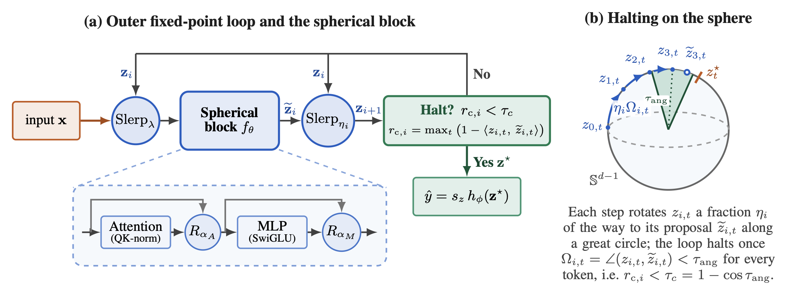
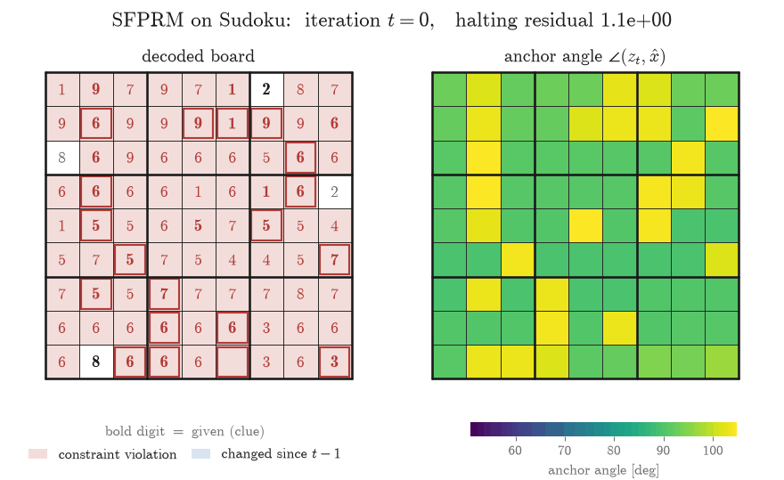
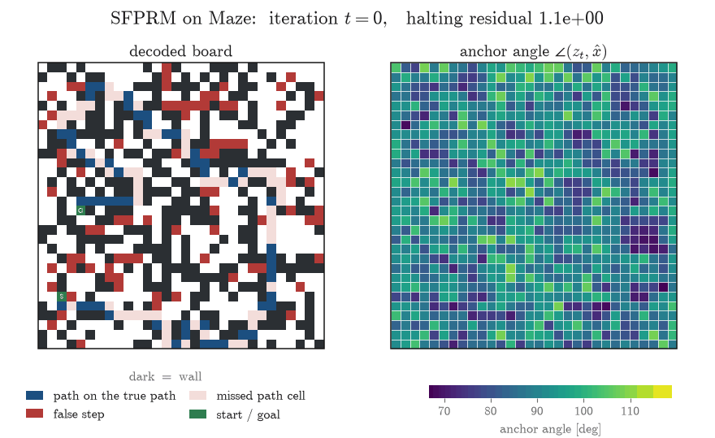
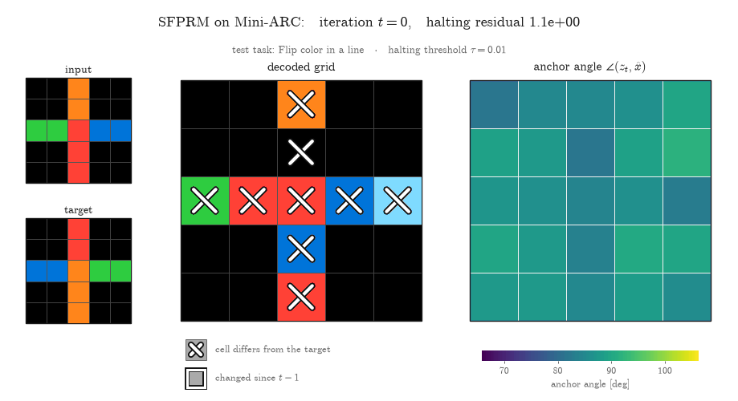
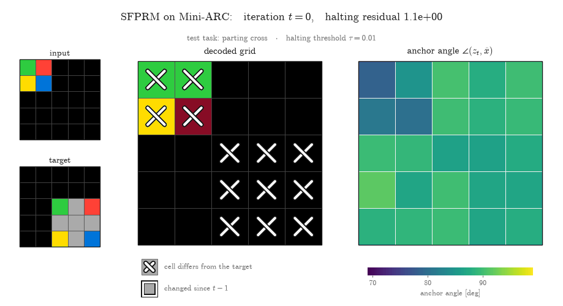
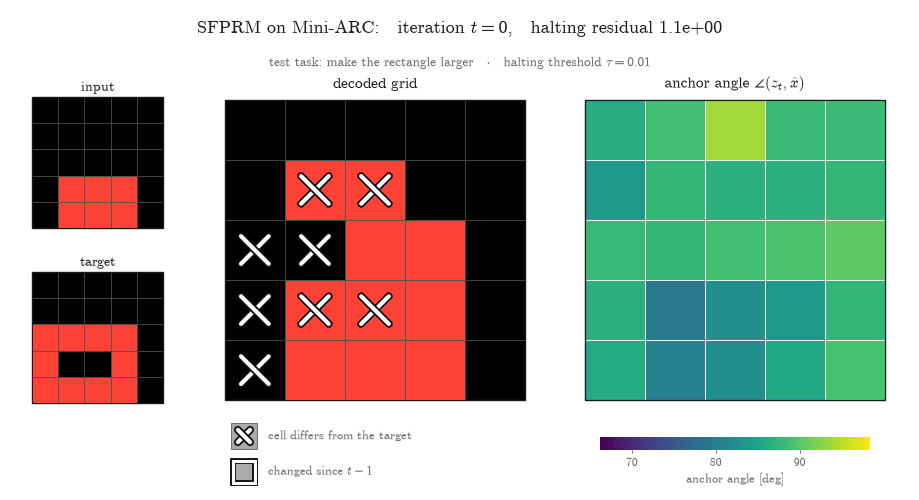
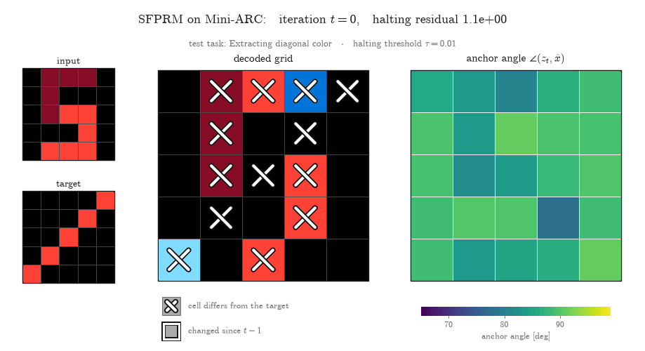

# Spherical Fixed-Point Reasoners: Adaptive Loop Halting on the Hypersphere

[📄 Paper (arXiv:2610.25646)](https://arxiv.org/abs/2610.25646)

Training and evaluation code, configs and checkpoints for **SFPRM**, the spherical variant of FPRM. SFPRM keeps FPRM's weight-tied looped Transformer block but keeps its fixed-point iterate on the unit hypersphere, with an nGPT-style normalized block and a damped geodesic solver that halts on a chordal residual. Tasks: Sudoku-Extreme, Maze-Hard (30×30), ARC-AGI-1, ARC-AGI-2 and Mini-ARC.

<p align="center">
  
</p>

## Rollouts

SFPRM solving test puzzles iteration by iteration: the board decoded from the current state (left) and each cell's angle to its input embedding, $\angle(z_t, \hat x)$ (right).

<p align="center">
  
  
</p>

Mini-ARC test tasks over 200 iterations: the test input and target, then the decoded grid and each cell's angle to its input embedding.

<p align="center">
  
  
  
  
</p>

## Installation

Requires Linux with an NVIDIA GPU (CUDA 12.x driver), Python 3.11–3.12 and [uv](https://docs.astral.sh/uv/). Run all commands from the repository root.

```bash
uv sync                      # create .venv/ and install all dependencies
source .venv/bin/activate    # or prefix every command with `uv run`
```

`uv sync` installs PyTorch from the CUDA 12.9 wheel index; `pyproject.toml` explains how to switch to the PyPI build.

- **Weights & Biases.** Training logs to W&B: run `wandb login`, or set `WANDB_MODE=offline`.
- **`torch.compile`** is on by default; `DISABLE_COMPILE=1` runs eagerly, e.g. where Triton cannot build. `evaluate.py` loads weights saved with or without the compiled model's `_orig_mod.` key prefix.

## Datasets

Datasets are not shipped; build them into `data/` first. Sudoku and Maze are downloaded from the Hugging Face Hub, ARC-AGI-1/2 and ConceptARC are in `kaggle/combined/`, and Mini-ARC is cloned from GitHub.

```bash
# Sudoku-Extreme: 5000 training puzzles x 200 augmentations (SFPRM)
python dataset/build_sudoku_dataset.py --output-dir data/sudoku-extreme-5k-aug-200 \
    --subsample-size 5000 --num-aug 200

# Sudoku-Extreme: 1000 training puzzles x 1000 augmentations (FPRM)
python dataset/build_sudoku_dataset.py --output-dir data/sudoku-extreme-1k-aug-1000 \
    --subsample-size 1000 --num-aug 1000

# Maze-Hard 30x30, NOT augmented (the 8x dihedral-augmented build collapses training to ~5%)
python dataset/build_maze_dataset.py --output-dir data/maze-30x30-hard-1k-noaug

# ARC-AGI-1 + ConceptARC, 1000 augmentations; test = the 400 ARC-AGI-1 evaluation tasks (~7 GB)
python -m dataset.build_arc_dataset --input-file-prefix kaggle/combined/arc-agi \
    --output-dir data/arc-aug-1000 \
    --subsets training evaluation concept --test-set-name evaluation

# ARC-AGI-2 + ConceptARC, 1000 augmentations; test = the 120 ARC-AGI-2 evaluation tasks (~9 GB)
python -m dataset.build_arc_dataset --input-file-prefix kaggle/combined/arc-agi \
    --output-dir data/arc2-aug-1000 \
    --subsets training2 evaluation2 concept --test-set-name evaluation2

# Mini-ARC: 149 tasks of 5x5 grids, 100 augmentations -> data/miniarc-aug-100
git clone https://github.com/KSB21ST/MINI-ARC raw_data/MINI-ARC
python -m dataset.miniarc_to_kaggle --src raw_data/MINI-ARC/data/MiniARC --out raw_data/miniarc
python -m dataset.build_miniarc_dataset --num-aug 100
```

## Checkpoints

The checkpoints are on the Hugging Face Hub at [arberzela/sfprm](https://huggingface.co/arberzela/sfprm), one folder each with weights, config, provenance notes and source copies. `config/` holds their training configs and the `arch/` defaults these build on.

```bash
hf download arberzela/sfprm --local-dir checkpoints                                      # all (4.0 GB)
hf download arberzela/sfprm --local-dir checkpoints --exclude "*_train_state.pt"         # without resume bundles (2.6 GB)
hf download arberzela/sfprm --local-dir checkpoints --include "sfprm-maze-step78120/*"   # one checkpoint
```

The FPRM authors' official Maze and Sudoku checkpoints also load here, with `cfg_pretrain_maze` and `cfg_pretrain_sudoku`:

```bash
hf download fixed-point-reasoners/fprm --include "maze/*"   --local-dir checkpoints/fprm-maze-official-hf
hf download fixed-point-reasoners/fprm --include "sudoku/*" --local-dir checkpoints/fprm-sudoku-official-hf
```

## Training

`pretrain.py` is the Hydra entry point; always pass `--config-name`.

```bash
python pretrain.py --config-name <config>                                            # one GPU
torchrun --standalone --nproc-per-node=<n_gpus> pretrain.py --config-name <config>   # several GPUs, one node

# 2 nodes x 4 GPUs: one torchrun per node, HEAD_NODE = hostname of the rank-0 node
torchrun --nnodes=2 --nproc-per-node=4 --rdzv-backend=c10d --rdzv-endpoint="$HEAD_NODE:29850" \
    pretrain.py --config-name <config>
```

- **Batch size.** `global_batch_size` (768 everywhere) is split over the GPUs and the gradients are summed, so the optimization does not depend on the GPU count.
- **Overrides.** `++key=value` adds or overrides any config field, e.g. `++run_name=my-run ++checkpoint_path=checkpoints/my-run`.
- **Checkpointing.** Every `eval_interval` epochs the run evaluates on the test split (with the EMA weights when `ema: true`), logs to W&B and writes `step_<N>` and `step_<N>_train_state.pt` to `checkpoint_path` (default `checkpoints/<project_name>/<run_name>`).
- **Resuming.** `++resume_from=<checkpoint dir>` restores the latest bundle there and continues the same W&B run.

### Reproducing the released checkpoints

```bash
torchrun --standalone --nproc-per-node=<n_gpus> pretrain.py --config-name cfg_pretrain_sfprm_sudoku   # SFPRM Sudoku
torchrun --nnodes=2 --nproc-per-node=4 --rdzv-backend=c10d --rdzv-endpoint="$HEAD_NODE:29850" \
    pretrain.py --config-name cfg_pretrain_sfprm_maze                                                 # SFPRM Maze
torchrun --standalone --nproc-per-node=4 pretrain.py --config-name cfg_pretrain_maze                  # FPRM Maze
torchrun --standalone --nproc-per-node=8 pretrain.py --config-name cfg_pretrain_sfprm_arc             # ARC-AGI-1
torchrun --standalone --nproc-per-node=8 pretrain.py --config-name cfg_pretrain_sfprm_arc2            # ARC-AGI-2
python pretrain.py --config-name cfg_pretrain_sfprm_miniarc                                           # Mini-ARC SFPRM
python pretrain.py --config-name cfg_pretrain_miniarc_fprm                                            # likewise _trm, _hrm, _eqr
```

- **Sudoku.** The schedule is a 60k-epoch cosine (`epochs: 60000`, `lr_min_ratio: 0.1`), but the released checkpoint is the epoch-15k evaluation (`step_97656`). Keep `epochs` (the LR schedule depends on it) and stop after epoch 15k: accuracy on the 1000-puzzle eval prefix is 0.984 at 15k, 0.980 at 20k, 0.864 at 25k and 0.475 at 30k.
- **Maze.** SFPRM fits at most 96 samples per 40 GB GPU, hence 8 GPUs; FPRM runs 192 per GPU on 4 × 80 GB GPUs.
- **ARC.** ARC-AGI-1 runs 100k epochs (518k steps); the final checkpoint is released. ARC-AGI-2 stopped at epoch 80k of 100k; its last evaluation, `step_579234`, is not released.
- **Mini-ARC.** One GPU per run (the 768 batch fits on 40 GB), 100k epochs (68,620 steps); the final checkpoint is released.

## Evaluation

`evaluate.py` runs the training loop's evaluation (`pretrain.evaluate`) on a checkpoint directory: it builds the model and test loader from `all_config.yaml`, loads `step_<N>` strictly and runs the halting loop over the full test split.

```bash
python evaluate.py checkpoints/<dir> [--batch B] [key=value ...]                       # one GPU
torchrun --standalone --nproc-per-node=<n_gpus> evaluate.py checkpoints/<dir> [...]    # several GPUs
```

FPRM and SFPRM halt a whole batch on its worst example, so the batch composition changes the result: evaluate with the per-GPU batch used in training. They also start from a random iterate, so repeated evaluations vary slightly.

### Results

| Benchmark | Model | Checkpoint | Metric | Result |
| --- | --- | --- | --- | --- |
| Sudoku-Extreme (422,786 puzzles) | SFPRM | `step_97656` | exact accuracy | 96.58% (95% CI 96.53–96.64) |
| Maze-Hard (1000 mazes) | SFPRM | `step_78120` | exact accuracy | 87.9% (in-run) |
| ARC-AGI-1 | SFPRM | `step_518065` | pass@1 / pass@2 | 41.25% / 46.62% (in-run) |
| ARC-AGI-2 | SFPRM | `step_579234` | pass@1 / pass@2 | 2.92% / 3.75% (in-run) |
| Mini-ARC (149 tasks) | SFPRM | `step_68620` | pass@1 | 59.1% |
| Mini-ARC (149 tasks) | HRM | `step_68620` | pass@1 | 51.7% |
| Mini-ARC (149 tasks) | EqR | `step_68620` | pass@1 | 40.3% |
| Mini-ARC (149 tasks) | TRM | `step_68620` | pass@1 | 36.9% |

Rows marked "in-run" are the values logged to W&B by the training run; the others come from `evaluate.py`. The sections below give the command and the caveats for each benchmark.

### Sudoku-Extreme (SFPRM)

```bash
torchrun --standalone --nproc-per-node=8 evaluate.py checkpoints/sfprm-sudoku-step97656 --batch 3072
```

This runs the full test set (422,786 puzzles) with the config's budget (`max_iter_eval` 35000, step-size decay 0.99, patience 5) and takes about 190 GPU-hours on A100-40GB, since up to 35,000 iterations run sequentially and larger batches barely help. It cannot resume; to fit a time limit, run contiguous shards as separate jobs and merge them:

```bash
python evaluate.py checkpoints/sfprm-sudoku-step97656 --batch 3072 --num-shards 8 --shard $i --out results/sudoku_eval/shard$i.json   # i = 0..7
python evaluate.py --merge results/sudoku_eval/shard*.json
```

For a quick check, `--sample 18432 --sample-seed 0` evaluates a seeded random subset: about ±0.13 points in 8 GPU-hours. The in-run W&B value (98.4%) covers only the first 1000 puzzles, which miss the hard tail.

### Maze-Hard (SFPRM, FPRM)

```bash
python evaluate.py checkpoints/sfprm-maze-step78120 --batch 96
python evaluate.py checkpoints/fprm-maze-step78120 --batch 192
python evaluate.py checkpoints/fprm-maze-official-hf/maze --config cfg_pretrain_maze --batch 192
```

The official checkpoint's `all_config.yaml` names the FPRM authors' code, so `--config` builds the model from `config/` instead. `--step` picks a `step_<N>` other than the latest.

### ARC-AGI-1 / ARC-AGI-2 (SFPRM)

In-run `eval/ARC/pass@K` of the training runs on the full augmented test split, with `max_iter_eval` 48: the solver is not contractive at this horizon, so longer rollouts drift off the good iterate and lower pass@K. The evaluator votes over all augmentations of each test pair and, in-run, keeps earlier evaluations' votes (`aggregated_voting`), so these values pool all checkpoints evaluated so far; the final checkpoint alone can differ.

### Mini-ARC (SFPRM, FPRM, TRM, HRM, EqR)

The final checkpoints (`step_68620`) scored alone on one GPU with the default seed, with the rollout cap raised to 200 fixed-point iterations (SFPRM/FPRM) or ACT segments (TRM/HRM/EqR). There are 149 tasks, so 1 task = 0.67 points.

```bash
python evaluate.py checkpoints/sfprm-miniarc-step68620 arch.max_iter_eval=200   # likewise fprm-
python evaluate.py checkpoints/trm-miniarc-step68620 arch.halt_max_steps=200    # likewise hrm-, eqr-
```

The training configs use shorter caps (`arch.max_iter_eval` 100, `arch.halt_max_steps` 16), so a retrained run's `eval/MiniARC_single/*` can differ from the Mini-ARC rows above; `eval/MiniARC/*` pools votes across evaluations, as for ARC, and reads higher.

## Citation

```bibtex
@misc{zela2026sfprm,
      title={Spherical Fixed-Point Reasoners: Adaptive Loop Halting on the Hypersphere},
      author={Arber Zela and Artavazd Maranjyan and Pol Puigdemont and David Berghaus and Valentyn Boreiko and Volkan Cevher},
      year={2026},
      url={https://arxiv.org/abs/2610.25646},
}
```

## Acknowledgments

- The code extends the FPRM release ([Fixed-Point Reasoners: Stable and Adaptive Deep Looped Transformers](https://arxiv.org/abs/2606.18206)).
- The puzzle tasks build on [TRM](https://github.com/SamsungSAILMontreal/TinyRecursiveModels).
- The EqR model is ported from [locuslab/EqR](https://github.com/locuslab/EqR).
- [Mini-ARC](https://github.com/KSB21ST/MINI-ARC) is by Kim et al.
